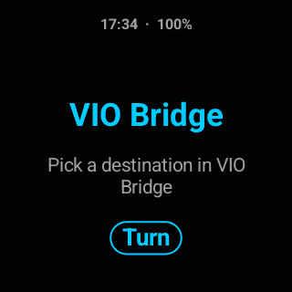

# VIO Bridge

[](https://github.com/mrapaul/vio-bridge/actions/workflows/build.yml)
[](LICENSE)

📖 **Project write-up:** <https://mrapaul.github.io/vio-bridge/>

An independent Android app that drives a **TomTom VIO** handlebar display from a
phone, showing turn-by-turn **bike** navigation — with its own routing engine, so
it works without the official TomTom scooter app.

<p align="center">
  
  <br>
  <em>Actual rendered VIO frames: turn-by-turn card, heading-up map, and arrival.</em>
</p>

The VIO is a small round 320×320 screen that pairs over Bluetooth and speaks
TomTom's "Forza" display protocol. VIO Bridge reverse-engineers just enough of
that protocol to render its own screens (map, directions, battery, clock) and to
read the VIO's touch input, battery and power events.

> **Unofficial.** Not affiliated with, endorsed by, or supported by TomTom. It is a
> personal interoperability project for hardware I own. Use at your own risk — see
> [Safety](#safety).

## What it does

- **Built-in bike navigation** — pick a destination and VIO Bridge routes you
  there over OpenStreetMap's cycling profile (OSRM), draws the route line and
  turn arrows on the VIO, and re-routes automatically when you leave the planned
  path. No Google Maps required.
- **Google Maps mirror (optional)** — if you'd rather navigate in Google Maps, it
  reads the cycling-navigation notification and mirrors the next manoeuvre to the
  VIO instead.
- **Battery-aware rendering** — unchanged frames aren't re-sent, and the screen
  auto-dims when no route is active, to spare the VIO's small battery.
- **Touch gestures** — tap / swipe on the VIO to switch screens and zoom the map.
- **Privacy-gated location** — GPS is only used while you are actively navigating
  by bike. Connecting the VIO alone never starts location tracking.

## How it works

| Piece | Notes |
|-------|-------|
| Transport | Bluetooth RFCOMM, Forza service UUID `e74e3827-fc47-4e5c-bcfa-be7a86d59331` |
| Handshake | VIO sends a sync request; the app answers with `FZA` and reads device info (firmware, 320×320 screen) |
| Rendering | Indexed-palette PNG frames streamed to the display channel |
| Input | Touch, battery level/status and power events arrive on the event channel |
| Routing | [OSRM](https://routing.openstreetmap.de/) bicycle profile; [Nominatim](https://nominatim.openstreetmap.org/) for destination search |

The project is deliberately small and has **no Gradle** — it builds straight from
`aapt2 → javac → d8 → zipalign → apksigner`.

### Key classes

- `VioService` — foreground service: owns the Bluetooth connection, the render
  loop, battery polling and the location lifecycle.
- `BikeRouter` / `Navigator` — fetch a cycling route and follow it with the GPS
  position, detecting off-route and re-routing.
- `Renderer` / `IndexedPng` / `TurnIcons` — draw the round screens and encode the
  palette PNG frames the VIO expects.
- `LocationTracker` — subscribes to GPS/network only while navigating.
- `RouteSimulator` — adb-triggered mock-GPS replay for testing routes and reroutes
  without riding.

## Building

Requires an Android SDK with build-tools 36 and a JDK 17+.

```sh
# Android SDK at $ANDROID_HOME, or defaults to ~/Android/Sdk
./build.sh
# → build/vio-bridge.apk
```

On first run `build.sh` generates a throwaway self-signed debug key at
`~/.android/vio-bridge.keystore` (never committed). This is a local development
key only — not a release/upload key.

## Installing

```sh
adb install -r --no-incremental build/vio-bridge.apk
```

Then grant the app the Bluetooth, Location and Notification-access permissions it
requests, pair the VIO, and open VIO Bridge to pick a destination.

## Safety

- **Never write to the VIO's firmware channel.** This project only uses the
  display, event and sync channels; the firmware-update channel can brick the
  device and is intentionally untouched. Don't add code that writes to it.
- Mount and read the display responsibly; don't interact with it while riding in
  a way that distracts you from the road.
- Reverse-engineered protocol behaviour may differ across VIO firmware versions.
  Developed against firmware 4.0.621.

## License

MIT — see [LICENSE](LICENSE).
